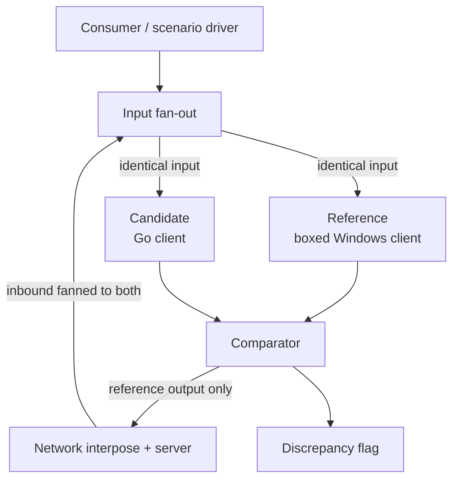
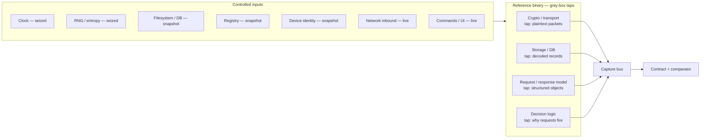
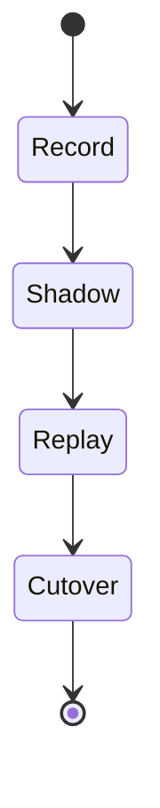

# Grey-box differential parity: using the official client as an oracle

**Status:** draft / proposal
**Scope:** interoperability research methodology for a clean-room KakaoTalk
secondary-device client. No credentials, captures, device identifiers, or
decompiled source belong in this document or this repository. Grey-box tap
offsets are in scope (see §11).

---

## 1. Summary

We want a public, self-hostable, clean-room Go implementation of a KakaoTalk
secondary-device client. The hard part is not writing Go — it is knowing that
the Go client behaves *exactly* like the official client, across every message
type, state transition, and timing-sensitive decision, including behavior that
has not yet been reverse-engineered.

This document proposes a way to get there that does not require guessing. We keep
the official client as a **reference oracle**, wrap it so it and our Go client
expose the **identical input/output contract**, run both on the same input, and
**flag every discrepancy** automatically. Crucially, we do not treat the official
binary as a pure black box: we hack a handful of **grey-box taps** into it so we
compare *plaintext and structured* data rather than opaque ciphertext, and so we
convert otherwise-uncontrollable inputs (clock, randomness) into captured,
replayable ones.

The official client is the oracle used to *build and verify* the Go client. The
Go client is the thing that ships.

---

## 2. Motivation

Two obvious strategies each fail on their own:

1. **Pure clean-room rewrite, verified by hand.** This is the conventional path:
   reverse the official client method-by-method, write an implementation-neutral
   spec, implement it in Go, and hand-author parity fixtures. It works, but
   verification is the bottleneck. Every untraced layer is a latent parity bug,
   and "trace the complete chain — request model, response model,
   callers/callbacks, persistent state, downstream consumers, failure behavior"
   is expensive to do by hand for every feature.

2. **Host the official client as the runtime** (lift it cross-platform, or run it
   boxed and bridge through it). This gives protocol parity for free but produces
   a bridge that is not meaningfully self-hostable (a GUI client per account), is
   a black box at its core, and throws away a working Go client. See
   [`docs/alternatives.md`](docs/alternatives.md) for why the "lift the Mac binary"
   and "run the real client forever" variants were rejected.

The approach here keeps the *verification* benefit of (2) without adopting it as
the runtime. The official client is an oracle on the bench, not a dependency in
production.

---

## 3. Core idea

Define a single **I/O contract** — the complete set of inputs a client consumes
and outputs it produces at a chosen boundary. Then:

- Wrap the official ("reference") client so its observable behavior is presented
  *as* that contract.
- Build the Go ("candidate") client to present the *same* contract — same inputs
  accepted, same outputs emitted.
- Run both on identical input, continuously, and diff their outputs. Any
  divergence is a flag: by default the candidate is wrong, unless the divergence
  is a deliberate, documented deviation.

Because the two sides are interface-identical, comparison is mechanical rather
than a judgment call, and promoting the candidate from "shadow" to "authoritative"
is a configuration switch rather than a rewrite.

---

## 4. Architecture overview



Key properties:

- **The reference defines the contract; the candidate conforms.** The contract is
  not designed in the abstract — it is whatever the reference is observed to
  accept and emit.
- **"Always run both" is safe because only the reference is authoritative.** Both
  sides receive identical input and both produce output, but the network interpose
  **gates outbound** so only the reference's packets reach the server. The
  candidate runs in permanent dry-run until cutover: its output is compared,
  never sent. This is what lets the harness run continuously, even against a live
  account, without the candidate being able to corrupt the session.
- **Inbound is fanned to both.** Server-originated data is received once and
  delivered to both sides so their inputs stay identical.

---

## 5. The grey-box reference: input surface and tap points

A pure black-box tap forces you to diff opaque, encrypted, or nondeterministic
representations — useless for finding real divergences. So we hack a small number
of taps into the reference binary. The governing principle:

> Wherever a black-box boundary would force you to diff an opaque, encrypted, or
> nondeterministic representation, hack a tap one layer **inward** to the
> plaintext / structured / deterministic representation.

"Network after decryption" is the first instance of this rule. The same rule
yields the storage, model, and decision taps, and the seizing of clock and RNG.



### 5.1 Input surface

Everything the reference's output can depend on, grouped by how it is neutralized:

**Seized** — nondeterministic, so hook the source to *record on the reference and
inject into the candidate*. This is the move that makes crypto-bearing output
diffable at all.

- **Clock** — system time, tick counts, high-resolution counters. Feeds
  timestamps, timeouts, retry timing.
- **RNG / entropy** — the CSPRNG and any hardware RNG. Feeds IVs, ephemeral keys,
  nonces, GUIDs, and client-generated message/request IDs.

**Snapshot** — persisted state; restore to a known baseline before each run.

- **Filesystem / DB** — the encrypted local message database, config, caches.
- **Registry** — platform config and install state.
- **Device identity** — device UUID / machine GUID / hardware identifiers, i.e.
  whatever derives the device-bound key.

**Live stream** — fed identically to both sides at run time.

- **Network inbound** — tapped *after decryption* (see §5.2).
- **Commands / UI** — the driven high-level actions.

**Not clean inputs, but still perturbing output:**

- **Thread scheduling** — the one genuinely hard nondeterminism. Mitigate by
  pinning to a single core and/or scoping parity to data + causal ordering, and
  treat fine-grained interleaving as acceptable-equivalence rather than a bug.
- **Environment / locale** — timezone, language. Fold into the snapshot.

### 5.2 Grey-box tap points

Four internal seams, each hooked to capture the *useful* representation:

1. **Crypto / transport → plaintext packets.** Hook after inbound decrypt and
   before outbound encrypt. Also **seize the negotiated session key and per-packet
   IV** at generation, so the capture can be decrypted *and* the same key material
   can be injected into the candidate for byte-identical ciphertext.
2. **Storage / DB → decoded records.** The filesystem analogue of
   network-after-decrypt: tap the serialization layer so you diff decoded rows,
   not the encrypted blob on disk.
3. **Request / response model → structured objects.** One layer above packets: the
   request/response structures the client builds and parses. Diffing structured
   objects localizes a failure to a field rather than a byte offset.
4. **Decision logic → why a request fires.** The caller/trigger hooks. This is
   where orchestration ("when and why does a member-list request fire?") becomes
   observable: you capture that a request fired *because* a push referenced an
   unknown member, not merely that it fired.

The capture bus collects all four taps plus the seized clock/RNG. That bundle *is*
the contract. Outbound packets and emitted events are not a separate output path —
they fall out of the crypto tap (before-encrypt) and the model/decision taps.

The payoff: a black-box diff can only say "the ciphertext differs." This grey-box
bus can say "the candidate's member-list request object has member IDs in a
different order, triggered one event later" — the difference between a flag you can
act on and one you cannot.

---

## 6. The contract

The contract sits at the **decrypted-packet + command/event boundary** — above raw
TLS/socket (so you never diff ciphertext you cannot align) and below the UI. Both
sides consume the same input bundle and emit the same output bundle.

```go
// Illustrative — not final. Field types follow the real decoded models.

// Input is everything a client consumes for one scenario step. Entropy and clock
// are part of the INPUT, not generated internally, so crypto-bearing output can
// match byte-for-byte across both implementations.
type Input struct {
    Commands  []Command      // high-level driven actions (send, open, fetch, ...)
    Inbound   []Packet       // decrypted server-originated packets
    Entropy   EntropyStream  // seized RNG: IVs, ephemeral keys, nonces, IDs
    Clock     ClockStream    // seized time: wall clock + monotonic reads
    Snapshot  SnapshotRef    // baseline fs/DB/registry/device identity
}

// Output is everything a client produces in response.
type Output struct {
    Outbound  []Packet       // decrypted packets the client would send
    Events    []Event        // events emitted toward the consumer/bridge
    Records   []Record       // decoded local-store writes
    Decisions []Decision     // which requests fired and why (trigger context)
}
```

Both the reference (via its grey-box taps) and the candidate (natively) produce an
`Output` for a given `Input`. The comparator diffs the two `Output`s.

---

## 7. The comparator

Because both sides emit the same type, diffing is structural. The only real design
work is the **equality policy**: what counts as equal.

- **Strict-by-default, field-whitelisted exceptions.** Most fields must match
  exactly. A small, explicit whitelist covers fields that are *legitimately free*
  (for example, values derived purely from seized entropy are already pinned, so
  they must match; values the protocol genuinely leaves to client choice are
  whitelisted and documented).
- **Ordering.** Data equality is strict; message/packet ordering is checked up to
  documented causal constraints, not wall-clock interleaving.
- **Divergence classification.** Every flagged diff is tagged **bug** (candidate
  is wrong — write a failing test, then fix) or **deliberate deviation** (candidate
  intentionally differs and is still correct for interop — record it with its
  rationale as a documented deviation). This is the one step that is review-gated
  rather than fully mechanical.

---

## 8. Operating modes



- **Record.** Drive the reference through a scenario; capture the full contract
  bundle (inputs incl. seized entropy/clock, and all tapped outputs). Produces
  `executed`-provenance fixtures.
- **Shadow.** Run both live. Inbound is fanned to both; the candidate runs
  dry-run (output compared, never sent); only the reference's output reaches the
  server. Flags accumulate against live traffic with zero account risk.
- **Replay.** Offline. Feed a recorded scenario to the candidate with the recorded
  entropy/clock injected and the recorded server side replayed. Deterministic and
  CI-friendly; this is where byte-exact parity is asserted.
- **Cutover.** Flip the gate so the candidate's output is authoritative for a
  scenario family that is green across the corpus. The reference is demoted to an
  offline oracle. Because the sides are interface-identical, cutover is a switch.

---

## 9. Determinism and its limits

Boxing the client makes it a deterministic function of its inputs — **as long as
every input is fixed**. One input is not fully controllable: the **live server**.

- The LOCO session is a two-way exchange whose server responses depend on the
  client's randomness. You cannot deterministically re-run a *live* session.
- Therefore the method is **record-once, replay-offline**: record a full
  controlled session (including server traffic) against a disposable account, then
  carve off a subsystem and diff it against the recording. Perfect parity is
  achieved against the *recording* (the oracle). Live cutover is a separate step
  that the oracle makes you confident about but does not itself prove.
- One-shot flows (registration nonces, device challenges) are record-replay-only
  by nature.

**Residual nondeterminism:** thread scheduling (see §5.1). Deterministic replay of
scheduling (rr-style) under an emulation layer is a research-grade effort and is
*out of scope*; instead we scope parity to data + causal ordering and accept
fine-grained interleaving as acceptable-equivalence.

**Coverage, not proof.** "Perfect parity" means perfect parity over the input
space actually exercised. Coverage is the permanent work, and the oracle must be
re-baselined on each official-client release.

---

## 10. Hosting the reference

The reference runs **boxed**: the official Windows client under Wine, in a
container, driven headlessly. This is the only host that is genuinely
Linux-self-hostable for the lab (macOS needs Apple hardware; Android needs a heavy
emulator stack), and it has direct precedent: the Matrix–WeChat bridges run the
Windows WeChat client under Wine with an injected hook. See
[`docs/alternatives.md`](docs/alternatives.md).

The single biggest unknown is cheap to resolve and should be the **first spike**:
does the current official Windows client launch and complete login under Wine on a
disposable, owned test account? If yes, attach the hook and confirm one inbound
decrypt tap and one driven send. Only then invest in containerization and
tap-offset stability.

### 10.1 CI pipeline

CI uses **replay only** (§8, §9). It never talks to the live server and needs no
account secrets. Recording is a manual step that runs on the operator's machine,
not in CI.

**Artifacts.** There are two private artifacts, both stored as private packages in
the GitHub Container Registry (GHCR):

- **Reference image** (`kakao-ref`). It has three layers, and the ones that change
  most often sit on top:
  1. Wine base.
  2. The official installer, downloaded at a pinned `KAKAO_VERSION` and verified
     against a pinned SHA-256, then silently installed. A version bump is a
     manual PR. The image is built from the upstream installer, so this repo
     never stores the binary.
  3. The grey-box taps plus the offset table for that exact version (§11). This
     layer is rebuilt on every change. Layers 1–2 come from a private registry
     build cache, so a tap change rebuilds in minutes.
- **Corpus** (`kakao-corpus`). These are recorded contract bundles (§6), pushed as
  an OCI artifact and keyed to the client version they were recorded on. The repo
  pins the corpus by digest in a lock file. Recordings come from disposable
  accounts, but they still contain raw server traffic, so §11 keeps them out of
  the repository.

**Jobs.**

| Job | Runs on | Needs | Checks |
|---|---|---|---|
| `go-test` | every PR, `main` | — | Unit tests and lint for the candidate. |
| `ref-build` | same-repo PRs, `main` | registry cache | The image builds. On `main` it pushes `kakao-ref:<sha>`. |
| `ref-selfcheck` | same-repo PRs, `main` | image, corpus | The reference replays the corpus and reproduces its own recorded outputs. This validates the taps and input-pinning shims after every tap change. |
| `parity` | same-repo PRs, `main` | corpus | The candidate replays the corpus, and the comparator (§7) diffs it against the recorded outputs. |
| `release` | `main` | — | If all jobs pass, it retags `kakao-ref:<sha>` as `kakao-ref:main` and prunes all but the last few `<sha>` tags. |

Every merge to `main` rebuilds the image and ships the code, taps, and image
together under one commit SHA. Same-repo PRs build the image without pushing and
run the same checks, so a broken tap fails before merge.

**Recording** runs locally against a disposable account, with the same image the
CI uses. Bumping the client version means re-recording, updating the offsets, and
pushing a new corpus version, all in one PR.

**Public-repo guards.** The repository is public, but the image (it contains the
official client) and the corpus are not.

- Jobs that touch the image or the corpus run only when the PR's head repository
  is this repository. Fork PRs get `go-test` only. Outside contributors' workflow
  runs require approval.
- Only this repository has access to the private packages, with `packages: write`
  only for `ref-build` on `main` and read access everywhere else.
- The image is never uploaded as a workflow artifact, and its build never uses the
  shared Actions cache, which PR workflows can read. It uses the private registry
  cache only.
- Logs and artifacts are public. Parity output is pass/fail plus field-level diffs
  of synthetic or redacted data. Raw corpus payloads are never printed.
- A package that has been made public can never be made private again. A CI step
  checks that an anonymous pull of the image fails.

**Cost.** Standard runners are free for public repositories. Image plus corpus
storage beyond the free allowance is on the order of a few dollars a month, which
a Packages spending limit caps.

---

## 11. Scope and safety

- Only inspect accounts, clients, devices, and traffic that the operator owns or is
  explicitly authorized to test. Prefer disposable test accounts.
- Never commit credentials, session material, tokens, device identifiers, phone
  numbers, private messages, raw captures, decrypted databases, or proprietary
  binaries. Store sensitive lab artifacts outside the repository and scan staged
  changes before every commit.
- Grey-box tap offsets and binary-specific addresses for the reference client
  *are* in scope. They are needed to rebuild the reference, and they live next to
  the tap code. Key every offset to the exact official-client version (and
  installer hash) it applies to.
- This repository documents an implementation-neutral methodology. Reproducible
  algorithms, storage/crypto recipes, necessary constants, and synthetic vectors
  that help authorized users interoperate are in scope; live secrets and
  identifying artifacts are not.
- Do not copy decompiled source or proprietary assets into any implementation.
  Document behavior as an implementation-neutral contract first.

---

## 12. Limitations and open questions

- **Wine compatibility** of the current official Windows client is unverified.
- **Anti-tamper / integrity / re-sign acceptance** on the boxed client is
  unverified; desktop clients are typically weaker here than mobile attestation,
  but this must be tested, not assumed.
- **Tap stability across versions** — grey-box tap offsets move on each release;
  the oracle needs re-baselining.
- **Business-logic parity** (the decision/trigger layer) is review-gated, not
  machine-exact; some divergence is legitimate implementation freedom.
- **Contract boundary placement** — the decrypted-packet + command/event boundary
  is the proposed seam; confirm it factors cleanly against the real decoded models.

---

## 13. Roadmap

1. **Wine spike** — launch + login the official Windows client on a disposable
   account; one inbound decrypt tap; one driven send.
2. **Contract v0** — pin the concrete Go types for `Input`/`Output` against the
   real decoded models; define the comparator's equality policy.
3. **Record mode** — input-pinning shims (clock, RNG, fs/registry snapshot) and a
   scenario recording format.
4. **Shadow mode** — fan-out + gated interpose; continuous diffing against live
   traffic on a disposable account.
5. **Replay mode** — deterministic offline parity in CI from the recorded corpus.
6. **Cutover** — per-scenario-family promotion of the candidate.
