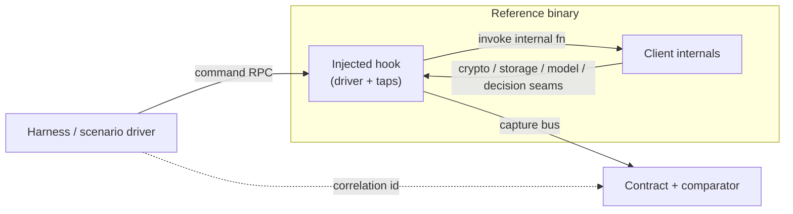

# Driving the reference client via an injected hook (command RPC)

Context for [`../DESIGN.md`](../DESIGN.md): how to **drive** the boxed reference
client — issue high-level actions (send a message, open a chat, fetch a member
list) — without UI scripting. This is the live `Commands` input surface of
DESIGN §5.1 and the `Input.Commands` field of the contract (§6), realized for the
reference side.

**Status:** draft / proposal. Scoping only — no hook code, no reversed entry
points, no offsets. The [`../patches/`](../patches/) seam stays empty until this is
reviewed and a spike passes.

---

## 1. Why not UI scripting

The obvious way to make the boxed client "do something" is to automate its GUI
(UIAutomation trees, synthetic `WM_` messages, pixel clicks). We reject that as the
driving mechanism:

- It couples driving to the window layout, which changes across releases and
  locales independently of the protocol.
- It produces **UI-level** events, not the decrypted-packet / structured-model
  representation the comparator diffs (§6). You would be driving at one layer and
  verifying at another.
- It is racy and headless-hostile: the spike host is Xvfb with no human, so modal
  dialogs, focus, and timing become their own nondeterminism on top of the one hard
  nondeterminism we already accept (thread scheduling, §5.1).

Driving should enter the client at the **same internal seam** the grey-box taps
read from, so a driven action and its tapped outputs land in one contract bundle
with no layer mismatch.

---

## 2. Mechanism: hook DLL loaded via `WINEDLLOVERRIDES`

This reuses **mechanism 1** from [`../patches/README.md`](../patches/README.md): an
injected hook DLL, loaded through the override seam already wired into
[`../docker/entrypoint.sh`](../docker/entrypoint.sh).

```
KAKAO_HOOK_OVERRIDES  →  WINEDLLOVERRIDES  →  Wine loads the hook DLL into the
                                              client process at startup
```

The entrypoint already does the wiring and defaults to empty (so the unmodified
client runs for the §13.1 launch spike):

```sh
# docker/entrypoint.sh, today:
export WINEDLLOVERRIDES="${KAKAO_HOOK_OVERRIDES:-}"
exec "$@"
```

To attach the driver later, the operator drops the built hook DLL into the Wine
prefix and sets `KAKAO_HOOK_OVERRIDES` so Wine loads it in *native, builtin* order
for the chosen module name, e.g. `KAKAO_HOOK_OVERRIDES="kakaodrive=n,b"`. Nothing
else in the pipeline changes. The DLL name and its loading convention are the only
new knobs; **which internal module it stands in for, and the entry points it
calls, are not committed** (§11, §12).

A single injected module serves both roles — it is both the **tap** (reads
outputs, §5.2) and the **driver** (injects commands, this doc). One hook, one
in-process vantage point, one capture/command bus out to the harness.

---

## 3. The command RPC

The hook exposes a small, local, line-oriented RPC the harness connects to. The
harness is the driver; the hook is the in-process executor.

### 3.1 Transport

- A **local** endpoint only: a Unix socket on the Wine-side (bridged out of the
  container by the harness) or a loopback-bound port inside the box. Never a
  listener reachable off the host.
- One connection per boxed client instance. The harness owns the lifecycle.
- Request/response, newline-delimited, structured payloads. The concrete encoding
  tracks the decoded models (same as the contract types, §6) rather than inventing
  a parallel schema.

### 3.2 Shape

Each request names a high-level action and its arguments; each response is an
acknowledgement with a correlation id, *not* the resulting protocol traffic (that
arrives separately on the capture bus — see §4).

```
// Illustrative — not final. Mirrors DESIGN §6 Input.Commands.

request   { id, action, args }         // e.g. action="send", args={chat, body}
response  { id, accepted|rejected, note }
```

Actions map **one-to-one** to `Input.Commands` entries in the contract:

| Driven action | Contract `Command` | Reaches the client at |
|---------------|--------------------|-----------------------|
| send a message | `send`  | the internal send path (same seam the model/decision tap reads) |
| open a chat     | `open`  | the chat-open entry point |
| fetch members   | `fetch` | the member-list request trigger |

The hook's job per request is to **invoke the client's own internal function** for
that action with the supplied arguments — the same function the GUI would have
called — and return `accepted` once the call is made. It does not synthesize
packets itself; it makes the client do the work, so all downstream behavior
(crypto, IDs from seized entropy, local-store writes) is the *client's*, exactly as
in an un-driven run.

### 3.3 Why acknowledgement-only

Keeping the RPC response thin (accept/reject + id) and routing all *effects* to the
capture bus is deliberate:

- The same effects must be observable whether an action was **driven** (via RPC) or
  **spontaneous** (client-initiated). If the RPC returned the resulting packets, the
  two paths would produce different records and the contract would stop being a
  single source of truth.
- The correlation id lets the comparator attribute a bundle of tapped outputs to
  the driving command that caused them — feeding the decision/trigger tap (§5.2
  point 4: "why a request fires").

---

## 4. Dovetailing with the capture bus

Driving and tapping share one injected module and one bus:



- **In:** the harness sends `Commands` over the RPC. The hook invokes the matching
  internal function. This is the reference's realization of `Input.Commands` (§6);
  the other inputs (inbound packets, seized clock/RNG, snapshot) are supplied as in
  the existing design.
- **Out:** everything the action causes falls out of the **existing taps** —
  before-encrypt outbound packets (crypto tap), decoded local-store writes (storage
  tap), structured request/response objects (model tap), and the trigger context
  (decision tap). The capture bus bundles those into one `Output`.
- **Correlation:** the RPC `id` is carried onto the emitted bundle so a driven
  command and its outputs are one unit. The candidate Go client, driven by the same
  `Commands`, produces its own `Output`; the comparator diffs the two (§7).

Net: driven action + tapped outputs land in the **same contract bundle** with no
UI layer in between, which is the whole point of preferring this over §1.

---

## 5. Smallest viable injection spike

Before any of §3–4 is built, resolve the one unknown that gates all of it, in the
style of [`../docker/verify-launch.sh`](../docker/verify-launch.sh) (which proves
only that the unmodified client launches). This spike proves the **injection
vector works at all** under Wine and that the hook can reach **one** internal
action.

Two staged checks, cheapest first:

### Spike A — does an injected DLL load into the client under Wine?

The minimal question from DESIGN's §10 spirit ("the single biggest unknown is cheap
to resolve"): can a `WINEDLLOVERRIDES`-selected DLL be loaded into the client
process at all.

- **Setup:** build a trivial do-nothing hook DLL that only records "I was loaded"
  (e.g. appends a line to a known path on `DllMain` attach). Drop it in the prefix,
  set `KAKAO_HOOK_OVERRIDES` to select it, launch the client as the launch spike
  does.
- **PASS:** the load-marker appears **and** the client is still running after the
  hold window (injection did not destabilize the process).
- **FAIL:** no marker (Wine did not honor the override for this module), or the
  client exits/crashes within the hold window (injection broke startup, or
  anti-tamper tripped — §6).

### Spike B — can the hook reach one internal send path?

Only run after A passes. Narrow the driver to a single action end-to-end, no RPC
server yet — a hardcoded one-shot is enough to prove reachability.

- **Setup:** extend the hook so that, once, after the client reaches a ready state,
  it invokes the internal send path with a benign payload to a self/echo
  destination on a **disposable, owned test account** (login is manual, per §11 —
  this spike is the first step that needs an account, unlike the launch spike).
- **PASS:** the send path executes and the action is observed **on the capture bus
  / tap** (an outbound send object appears at the before-encrypt seam), confirming
  the driver and the tap see the same event.
- **FAIL:** the internal entry point cannot be called from the hook, the client
  rejects/ignores the call, or nothing appears at the tap.

### Pass/fail discipline

Mirror `verify-launch.sh`: a single process, explicit hold window, one line of
`PASS:`/`FAIL:` to stdout/stderr and a matching exit code, last log lines dumped on
failure. The spike scripts, when written, live under
[`../docker/`](../docker/) alongside `verify-launch.sh`; the hook itself lives in
[`../patches/`](../patches/) as a reviewed artifact. **Neither is committed by this
doc.**

---

## 6. Open questions and risks

- **Internal entry points move per release (the §12 re-baseline tax).** The send /
  open / fetch functions the hook invokes are version-specific and are **not**
  committed (§11). Every official-client release re-baselines them, exactly as it
  re-baselines the tap offsets. This is the dominant recurring cost of the approach
  and the main argument for keeping the *driver* and *tap* in one module so they
  re-baseline together.
- **Anti-tamper / integrity checks (§12).** Injecting a DLL and calling internal
  functions is more invasive than the read-only launch spike. The client may detect
  a foreign module or a modified call path. Desktop clients are typically weaker
  here than mobile attestation, but this is **unverified** and Spike A's crash/exit
  FAIL condition is the first probe of it. If integrity checks block injection, the
  fallbacks are a reviewed post-install binary patch (patches/README mechanism 2) or
  reconsidering option 3 (a native local IPC, if one exists) — tracked separately.
- **Entry-point stability of the *ABI*, not just the address.** Even with addresses
  re-baselined, calling convention / argument shape of an internal function can
  change silently. Driven sends that "succeed" but produce subtly different objects
  would surface as comparator flags — acceptable, but worth noting the driver can be
  a *source* of spurious divergence, not only the candidate.
- **Readiness / ordering.** The hook must know when the client is ready to accept a
  driven action (post-login, connection established). Driving too early is a race.
  The decision tap helps here (it observes client state), but the RPC needs a
  defined "ready" signal before it accepts commands.
- **Scope of the RPC surface.** §3 lists send/open/fetch as the first actions. The
  full `Commands` vocabulary grows with the scenarios the harness drives; each new
  action is another internal entry point to locate and re-baseline. Keep the RPC
  action set tied to actual scenario needs, not speculative coverage.

---

## 7. Where this sits in the roadmap

This is the driver half of DESIGN §13 step 1's follow-on: the launch spike (§13.1)
boxes the **unmodified** client; this doc's Spike A/B is the next increment —
**injection works, one action reachable** — which unblocks Record mode (§13.3,
driving the reference to capture fixtures) and Shadow mode (§13.4, driving both
sides live). It changes nothing about the contract (§6) or comparator (§7); it only
supplies the reference's `Input.Commands`.
